# BMW iDrive 7 Games (MGU)

Games for BMW iDrive 7 (MGU head units), for when the car is parked: drawn by the **mgu-render** GPU renderer at 60 fps, played with the iDrive controller or the touchscreen. Compatible with **Robert Nisipeanu's mgu-store**.

Every game is **parked only**: it pauses (or deals no new hand) as soon as the car moves above 3 km/h. The casino games use **play credits only**: nothing to buy, nothing to win.

The car apps (Engine Care, Hybrid Cost) are in [aurelmarius/bmw-apps](https://github.com/aurelmarius/bmw-apps).

---

## 🎮 Games

### 1. 🐍 Snake (`aurelm_snake`)
*The classic game, drawn by the GPU renderer at 60 fps. Parked only.*

* **Smooth at any speed**: the snake slides between cells every frame (mgu-render); without the renderer it still runs as HMI images, a few frames a second.
* **iDrive controller**: push to go that way, turn to turn left / right, press to pause. Paused: push left leaves the app, a turn hands the controller back to the button bar and Settings.
* **Touchscreen**: swipe to steer, tap on the board to turn towards the tap, tap beside it to pause.
* **Settings**: speed (slow / normal / fast, faster with every food), edges (wrap around or solid walls), colour theme.
* **Best score** kept for each speed and edge setting.
* **Parked only**: pauses as soon as the car moves (above 3 km/h) and can't be started while driving.

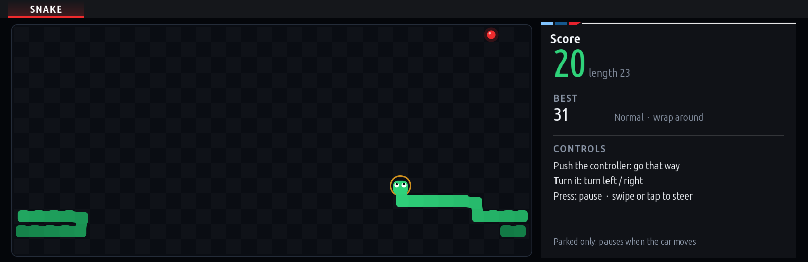
<sub>Screenshot drawn by the app on a PC (`tools/screenshots.js`), a game played by an autopilot.</sub>

### 2. 🚀 Track Defender (`aurelm_track_defender`)
*An arcade shooter: drones attack the track in waves, the M car shoots them down. GPU renderer at 60 fps. Parked only.*

* **Waves of drones**: they fly in on curves to a formation that sways and slowly sinks towards the track; some dive at the car and fire on the way. Heavy drones take two hits, every fifth wave is a boss drone.
* **Barriers** between the car and the drones crumble under the drones' fire; the car's own shots pass through.
* **The car fires by itself**: the **iDrive controller** drives it (turn = left / right, push left / right = a longer step), push up fires the **pulse** (clears the sky of bullets, hits every drone; charges again in 15 s), press pauses. On the **touchscreen** the car follows your finger, a tap on the pulse meter fires it.
* **Power-ups** from downed drones: double fire, a guard that takes one hit, an extra life.
* **Particle explosions, drifting stars, glowing shots** - all drawn by mgu-render every frame.
* **Settings**: difficulty (easy / normal / hard), colour theme. Best score kept for each difficulty.
* **Parked only**: pauses as soon as the car moves (above 3 km/h) and can't be started while driving.

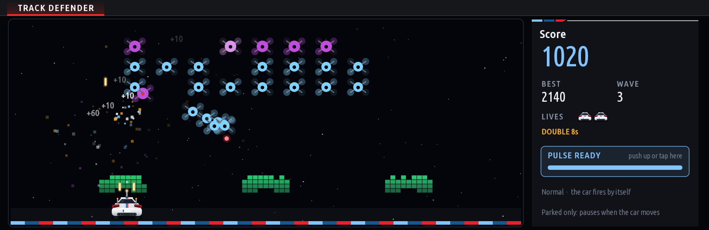
<sub>Screenshot drawn by the app on a PC (`tools/screenshots.js`), a game played by an autopilot.</sub>

### 3. 🏁 Pit Wall (`aurelm_pit_wall`)
*Break the advertising panels off the pit wall, catching the ball on an M front wing. A night race scene at 60 fps. Parked only.*

* **The scene**: floodlights over a grandstand full of camera flashes, glossy sponsor panels that shatter into shards, carbon panels that crack before they go, fuel cans that explode and take their neighbours with them (the screen shakes).
* **Start lights**: every level starts with five red lights; the ball goes when they go out.
* **The wing**: where the ball hits it sets the angle; the ball speeds up with every panel.
* **Combos**: panels in a row without touching the wing multiply the score (x2 .. x5).
* **Power-ups**: DRS (a wider wing), split (three balls), turbo (the ball burns through panels), slow ball, extra life.
* **Six walls** (Main Straight, The Wedge, Three Stripes, Chicane, Diamond, The Circuit), harder each round.
* **iDrive controller**: turn to move the wing, push left / right for a longer step, press to launch (or pause). **Touchscreen**: the wing follows your finger, tap to launch.
* **Settings**: ball speed (relaxed / normal / fast), colour theme. Best score kept for each ball speed.
* **Parked only**: pauses as soon as the car moves (above 3 km/h) and can't be started while driving.

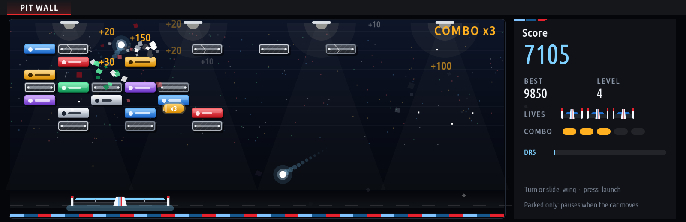
<sub>Screenshot drawn by the app on a PC (`tools/screenshots.js`), a game played by an autopilot.</sub>

### 4. 🎰 Lucky Sevens (`aurelm_lucky_sevens`)
*A five reel slot machine for play credits, drawn by the GPU renderer at 60 fps. Parked only.*

* **The machine**: a lacquered cabinet in a gold moulding with marquee bulbs, reels behind curved glass in a chrome bezel, glossy symbols lit from the top left (an extruded 7 with a gold rim, cherries, lemon, bell, BAR, a cut diamond, the WILD star), a control panel with LCD read-outs and a domed SPIN button.
* **Reels that feel real**: each winds up, runs with a motion blur, and stops one after the other with a small bounce; the bulbs chase round the machine while they run.
* **Ten paylines**, paid left to right from the first reel (cherries from two), **WILD** stands in for any symbol. A win lights its lines one by one, frames the symbols that pay (the higher ones in light rays), counts up into the credits; a big win throws a fountain of coins over the machine.
* **Free spins**: three WILDs anywhere in the window give **10 free spins** at the bet that won them, every win paid **x2**; WILDs again in a free spin give 10 more. They're announced, run by themselves, and the round ends with what it won.
* **Progressive jackpot**: every paid bet adds 1% to a pot (starting at 10 000) shown on the cabinet. **Five sevens on a line** (no WILD) win it: all of it at 50 per line, a share at a smaller bet. It comes on top of the line's own pay.
* **Statistics** (STATS key, or push the controller down): spins, credits bet and won, paid back %, best win, longest winning streak, free spin rounds, jackpots won, best jackpot, the jackpot at your bet.
* **Bet** 1 to 50 per line, **max bet**, **autoplay**; press while the reels run to stop them at once.
* **iDrive controller**: press = spin, turn = bet, push up = autoplay, push right = max bet, push down = statistics. **Touchscreen**: the panel's keys, or tap the reels to spin.
* **Play credits only**: nothing to buy, nothing to win. Out of credits, the SPIN button gives 1 000 new ones. The machine pays back about 96 of every 100 credits bet, free spins and jackpot included. Credits, bet, the jackpot, free spins left and the statistics are kept between drives.
* **Settings**: cabinet colour (ruby / sapphire / emerald / onyx), reel speed (normal / fast).
* **Parked only**: no spin while the car moves (above 3 km/h), autoplay goes off.

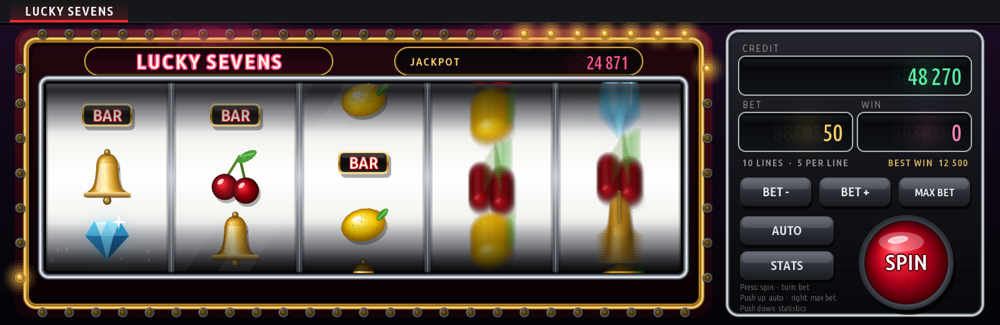
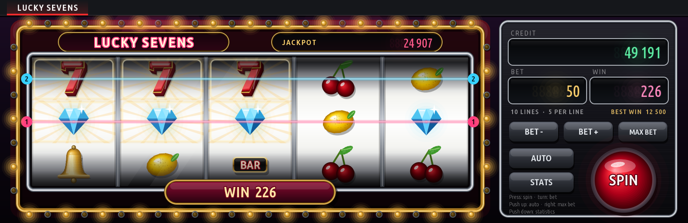
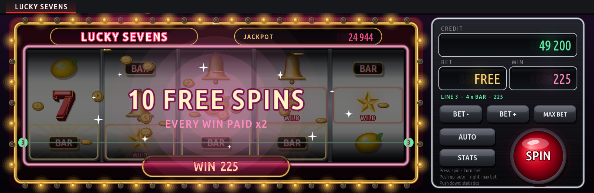
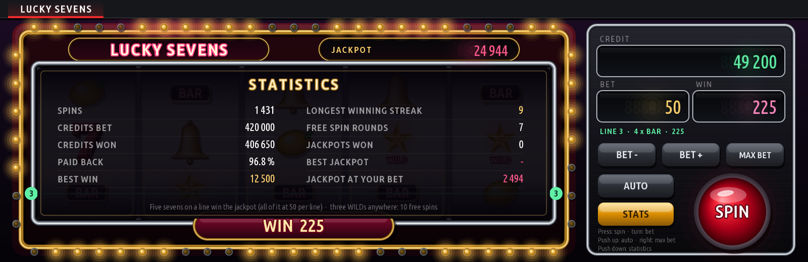
<sub>Screenshots drawn by the app on a PC (`tools/screenshots.js`), seeded spins.</sub>

### 5. 🃏 Blackjack (`aurelm_blackjack`)
*Casino blackjack for play credits, drawn by the GPU renderer at 60 fps. Parked only.*

* **The table**: felt lit from above, a padded leather rail along its curved edge, the table's printing in gold along the arc, the dealer's chip rack, the shoe and the discard tray. Cards with real pips and court cards in a gold frame, casino chips in perspective.
* **Dealt like at the casino**: the cards fly from the shoe and settle in a fan, the dealer's hole card turns over, chips slide to the bet, winnings come from the dealer's rack, lost bets go to it, finished cards go to the discard tray.
* **Casino rules**: six decks shuffled again at the cut card, the dealer stands on 17 and peeks for blackjack, blackjack pays 3 to 2, double on any two cards (also after a split), split pairs up to four hands (split aces take one card), insurance pays 2 to 1.
* **Strategy hint** (setting): the key basic strategy plays lights up, and the panel says why (e.g. `11 vs 5 · TIP: DOUBLE`).
* **Statistics** (STATS key, or push the controller down): hands, won, lost, pushes, blackjacks, win rate, best win, longest winning streak, doubles and splits, paid back %.
* **iDrive controller**: betting: press = deal, turn = bet; playing: turn to choose HIT / STAND / DOUBLE / SPLIT and press, or push up = hit, down = stand, right = double, left = split. **Touchscreen**: the panel's keys.
* **Play credits only**: nothing to buy, nothing to win. Out of credits, DEAL gives 1 000 new ones. Credits, bet and statistics are kept between drives.
* **Settings**: table felt (green / blue / red / black), card backs (M Tricolour: carbon fibre with the three M stripes / red / blue), dealing speed, strategy hint on / off.
* **Parked only**: no new hand while the car moves (above 3 km/h); a hand in play waits.

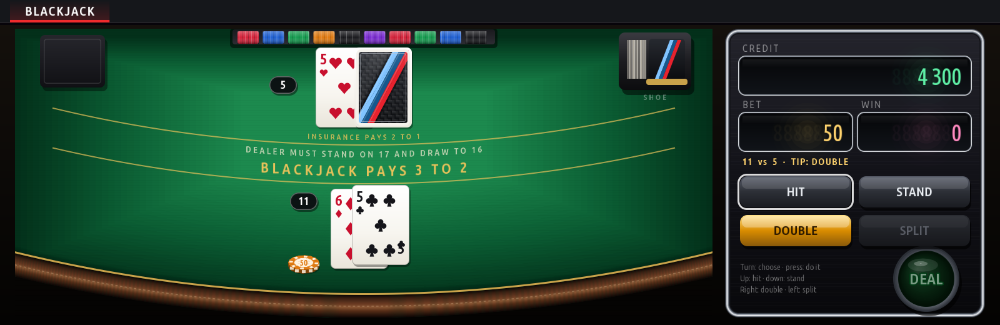
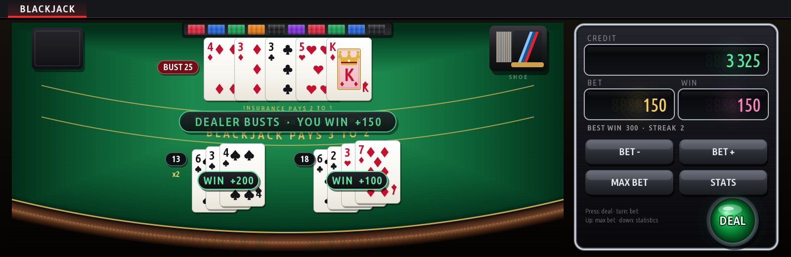
<sub>Screenshots drawn by the app on a PC (`tools/screenshots.js`), seeded hands played by basic strategy.</sub>

### 6. ♠️ Solitaire (`aurelm_solitaire`)
*Klondike, the classic patience, on a card table. GPU renderer at 60 fps. Parked only.*

* **The table**: felt lit from above in a dark wooden frame with a brass inlay, the places for the piles printed on it (each foundation with its suit), the same cards as Blackjack.
* **Cards that move like cards**: every card slides to where it belongs, so a deal, a move, a draw or an undo flies by itself; a card turned over flips; a won game sends the cards bouncing off the foundations, leaving a trail.
* **One move at a time, the best one**: tap a card (or press on a pile with the controller) and it goes where it plays best: to its foundation, onto a column so a hidden card turns over, a king to an empty column. Or drag cards where you want them.
* **Draw one or three**, the waste goes back over as often as you like; **undo** as far back as you like; **hint** (the cards to move and where, in cyan); when nothing is hidden any more the cards **go up by themselves**.
* **Score** as the classic game has it (waste to tableau 5, to a foundation 10, a card turned over 5, a card back from a foundation -15, the waste over again -100 / -20, a time bonus on a win), **time** and **moves**.
* **Statistics**: games played and won, win rate, best time, best score, winning streak.
* **iDrive controller**: turn = from pile to pile, press = the best move (on the stock: draw), push up = undo, down = hint, right = draw. **Touchscreen**: tap or drag; the panel's keys.
* **The game in progress is kept** between drives; the clock runs only while the game is on screen and the car stands still.
* **Settings**: draw one / three, table felt (green / blue / red / black), card backs (M Tricolour: carbon fibre with the three M stripes / red / blue).

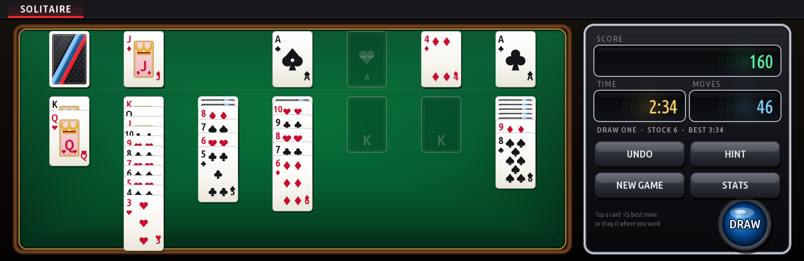
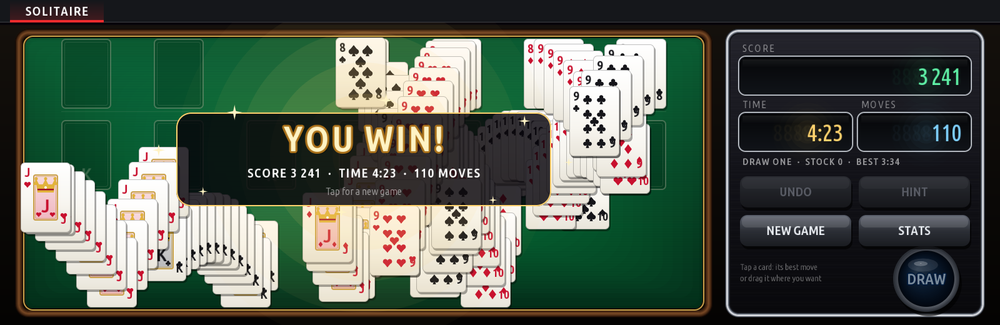
<sub>Screenshots drawn by the app on a PC (`tools/screenshots.js`), seeded deals played by the hint.</sub>

### 7. 🏎️ Apex Chase (`aurelm_apex_chase`)
*A maze chase in a city at night: the M car against four electric cars. GPU renderer at 60 fps. Parked only.*

* **The city from above**: asphalt streets with lane marks and pools of street-lamp light, blocks of buildings with lit windows and rooftop plant, parks with trees, tunnels at both ends of the middle avenue, the charging station in the middle. Two cities, in turns from level to level.
* **The M car** (white, blue, green, red or yellow, with the three stripes on its bonnet and its headlights on the street) collects the fuel drops on every street.
* **Four electric cars** hunt it, each its own way: **Volt** goes for the car, **Spark** for where it's heading, **Amp** for the street behind it, **Watt** comes close and then turns away; now and then they all go round their own corner of the city.
* **NITRO**: a can in each corner drains the electric cars' batteries: they crawl and flee (a red battery blinks over them), and one caught goes back to the charging station: 200, 400, 800, 1600.
* **Bonus** items (chequered flag, trophy, wrench, race tyre, key) under the station, an extra car at 10 000; every cleared city is faster, the nitro shorter.
* **iDrive controller**: push the way to go (kept until the car can turn), turn = right / left, press = pause. **Touchscreen**: swipe the way to go.
* **Settings**: difficulty (easy / normal / hard: how fast the electric cars are, how long a nitro lasts), your car's paint. Best score kept for each difficulty.
* An original game: its own city, cars and rules; the electric cars are generic, with no make's badge.

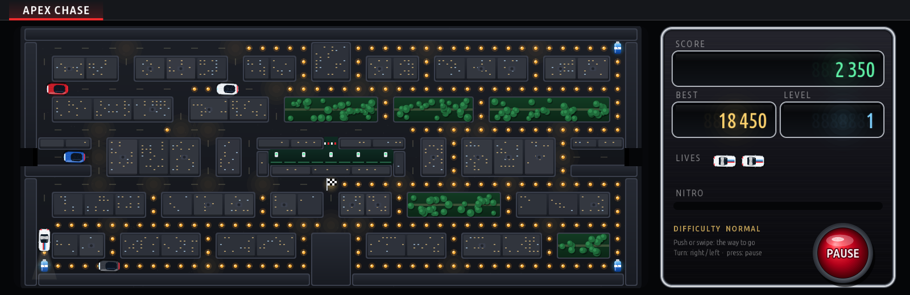
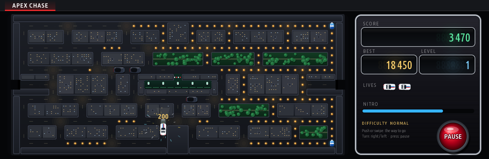
<sub>Screenshots drawn by the app on a PC (`tools/screenshots.js`), played by an autopilot.</sub>

### 8. 🛡️ Street Siege (`aurelm_street_siege`)
*Defend the M garage: cars storm an industrial yard at night, the M car stops them with its roof cannon. GPU renderer at 60 fps. Parked only.*

* **The yard from above**: asphalt with painted bays, cracks, drains and pools of lamp light; stacks of race tyres (red and white) that fall apart brick by brick when shot, concrete barriers with hazard stripes, a canal (cars can't cross it, shots can), trees whose crowns hide the cars under them, oil patches that make a car slide on. Every level its own yard (symmetric, reachable everywhere).
* **Twenty cars a level**, four on the yard at most, in from the top: **hatchbacks** (fast), **vans**, **pick-ups** (they fire twice as often), **armoured SUVs** (four hits; they go rusty, then scorched). Three of them flash: hit, they leave a power-up.
* **Power-ups**: CANNON (faster shots, then two at a time, then through concrete), SHIELD, NITRO (the others stand still), FORTRESS (concrete round the garage for a while), +1 CAR, EMP (every car on the yard gone).
* **The garage** stands three hits (it smokes; two hits at once count as one); lost, or with no cars left, it's over. The M car's own shots don't hurt it.
* **Explosions** with sparks, smoke and a shake, chips of tyre and concrete flying, tracers, a shield that turns round the car.
* **iDrive controller**: push and hold the way to drive, press = fire, turn = pause. **Touchscreen**: a joystick where the finger goes down on the yard, a tap or FIRE fires. **Automatic fire** (a setting, on): the cannon fires by itself at a car in its line.
* **Settings**: difficulty (easy / normal / hard), automatic fire, your car's paint. Best score kept for each difficulty.
* An original game in the genre of arena tank shooters: its own yards, cars and rules; no make's badge on any car.

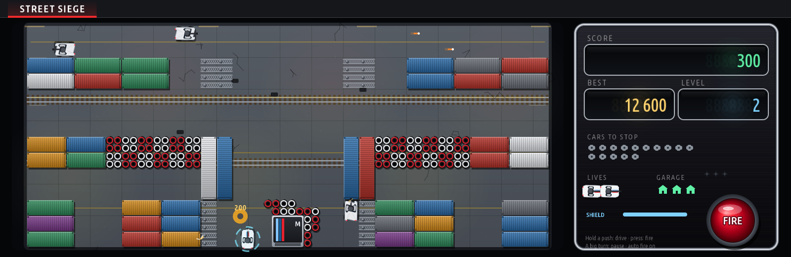
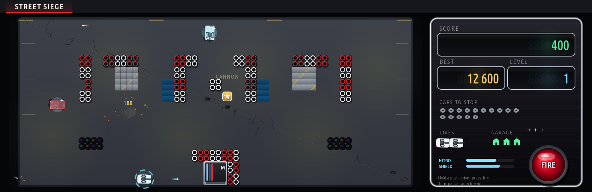
<sub>Screenshots drawn by the app on a PC (`tools/screenshots.js`), played by an autopilot.</sub>

### 9. 🕹️ M Pinball (`aurelm_pinball`)
*A pinball table on the circuit, seen in perspective so the whole table fits the wide screen. GPU renderer at 60 fps. Parked only.*

* **Real ball physics**: a steel ball rolling under gravity, stepped 480 times a second; walls, posts, rubbers and flippers it bounces off as it should. A ball batted near the flipper's tip goes across the table, one near its pivot goes straight up.
* **The table**: three **wheels** for bumpers (1 000), two slingshots, the **GEARS** lanes 1 2 3 at the top (all three lit: the bonus gears up to x5; the flippers move the lit lanes along), the **M-POWER** targets, the **PIT LANE** saucer, the **CHICANE** ramp in clear blue plastic with red and white kerbs and a wire that brings the ball back to the left flipper.
* **Shots**: the CHICANE from the left flipper (a lap: 25 000, a combo up to x4 within 4 s; every 5th lap: FASTEST LAP and an extra ball lit at the pit), the PIT LANE from the right flipper. All six M-POWER letters open the pit: **SAFETY CAR MULTIBALL**, three balls, every lap a **JACKPOT** (500 000, +100 000 each).
* **Skill shot**: the lane blinking while the ball waits on the plunger, 100 000 when the launched ball rolls through it. **Ball save** after each launch (SHOOT AGAIN lit), **NUDGE** (the third within 6 s: TILT), an end-of-ball **bonus** times the gear.
* **A dot-matrix display** in the panel (score, ball, gear, what's lit, the big moments), the M-POWER lamps, the plunger's power.
* **iDrive controller**: push left / right and hold = that flipper, press and hold = both. **Launching, three ways**: hold the press and let go (the longer, the stronger), turn the knob to pull the plunger a notch at a time and press to let go, or push down and hold, let go. Push up = nudge. **Touchscreen**: a finger on the left half of the table = the left flipper while it's down, the right half = the right one; hold LAUNCH and let go, or pull the plunger down with a finger.
* **Settings**: difficulty (easy: a slower ball and a long ball save; hard: faster, a short one), 3 or 5 balls. Best score kept for each.
* An original table: its own layout, rules and art; no make's badge on it.

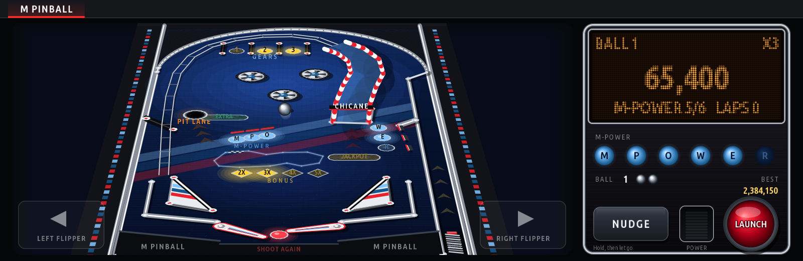

<sub>Screenshots drawn by the app on a PC (`tools/screenshots.js`), played by an autopilot.</sub>

---

## 🚀 Installation

### Method 1: Via mgu-store (Recommended)
1. Open **Store** on your BMW central display.
2. Go to **Settings** -> **Add source**.
3. Enter:
   ```text
   aurelmarius/bmw-games
   ```
4. Select **Releases** as the source type.
5. Tap **Install** next to **Snake**, **Track Defender**, **Pit Wall**, **Lucky Sevens**, **Blackjack**, **Solitaire**, **Apex Chase**, **Street Siege** or **M Pinball**.

The games run smoothest with the **mgu-render** GPU renderer, installed from the same Store. Without it they still run, as images handed to the HMI a few times a second.

**Installed a game from v1.1.3 or older?** The games' ids now carry the `aurelm_` prefix (`aurelm_snake`, …), as the Store's publishing guide asks, so the Store sees them as new apps: install them again, then remove the old ones (without the prefix) from the Store. Best scores, credits and statistics start afresh.

### Method 2: Via USB Stick
1. Download the `<game>@<version>.tgz` files from [Releases](https://github.com/aurelmarius/bmw-games/releases).
2. Copy the files onto a USB stick or build a USB repository:
   ```powershell
   node mgu-install.js usb-repo E:\ aurelm_snake@1.0.0.tgz aurelm_track_defender@1.0.0.tgz aurelm_pit_wall@1.0.0.tgz aurelm_lucky_sevens@1.1.0.tgz aurelm_blackjack@1.0.1.tgz aurelm_solitaire@1.0.0.tgz aurelm_apex_chase@1.0.0.tgz aurelm_street_siege@1.0.0.tgz aurelm_pinball@1.0.0.tgz
   ```
3. Insert the USB drive into your car and install from the **USB** page of the Store.

### Method 3: Manual Deployment via SSH
Copy the package to the head unit and run `mgu-deploy.sh`:
```bash
/var/opt/mgu-deploy/mgu-deploy.sh install --artifact aurelm_snake@1.0.0.tgz --yes
/var/opt/mgu-deploy/mgu-deploy.sh install --artifact aurelm_track_defender@1.0.0.tgz --yes
/var/opt/mgu-deploy/mgu-deploy.sh install --artifact aurelm_pit_wall@1.0.0.tgz --yes
/var/opt/mgu-deploy/mgu-deploy.sh install --artifact aurelm_lucky_sevens@1.1.0.tgz --yes
/var/opt/mgu-deploy/mgu-deploy.sh install --artifact aurelm_blackjack@1.0.1.tgz --yes
/var/opt/mgu-deploy/mgu-deploy.sh install --artifact aurelm_solitaire@1.0.0.tgz --yes
/var/opt/mgu-deploy/mgu-deploy.sh install --artifact aurelm_apex_chase@1.0.0.tgz --yes
/var/opt/mgu-deploy/mgu-deploy.sh install --artifact aurelm_street_siege@1.0.0.tgz --yes
/var/opt/mgu-deploy/mgu-deploy.sh install --artifact aurelm_pinball@1.0.0.tgz --yes
```

---

## 🛠️ Technical Details

* **Platform**: BMW MGU (Media Graphics Unit) / iDrive 7
* **Framework**: Node.js OAP SDK (`oap-sdk`), BMW RHMI UI descriptions
* **Renderer**: Hardware-accelerated GPU canvas (`mgu-render` / `mgu-renderd`); every game draws with the kit's recorder (rects, gradients, quads, arcs, text) and caches what doesn't change as layers
* **Input**: the iDrive controller (held by the game while it's on screen), the touchscreen, the HMI's button bar
* **Kit**: `kit/` is the [iDrive 7 custom apps](https://github.com/cauliflowermossgrape/idrive7-apps) kit (MIT), with the packaging changes for mgu-store in `kit/tools/build.py`

---

## 🧪 Development

```bash
python3 kit/tools/build.py aurelm_snake aurelm_track_defender aurelm_pit_wall aurelm_lucky_sevens aurelm_blackjack aurelm_solitaire aurelm_apex_chase aurelm_street_siege aurelm_pinball  # -> dist/<id>@<version>.tgz
node kit/tools/preview.js dist/aurelm_blackjack preview        # a game on a simulated head unit, as PNGs
node tests/snake.test.js                                # Snake's rules
node tests/track_defender.test.js                       # Track Defender's rules
node tests/pit_wall.test.js                             # Pit Wall's rules
node tests/lucky_sevens.test.js                         # Lucky Sevens' rules
node tests/blackjack.test.js                            # Blackjack's rules
node tests/solitaire.test.js                            # Solitaire's rules
node tests/apex_chase.test.js                           # Apex Chase's rules
node tests/street_siege.test.js                         # Street Siege's rules
node tests/pinball.test.js                              # M Pinball's rules and physics
node tools/screenshots.js                               # the README's screenshots (after a build)
```

Each game (its id: `aurelm_` and its name) keeps its rules in `apps/<id>/model.js` (no drawing, no car: that's what the tests run), its look in `art.js` where it has one, and the screen, the controller and the timing in `main.js`.

**Releasing**: build, copy the new `dist/*.tgz` into `packages/` (remove the old version of that game) and push. The push of `packages/` runs the *Prepare Draft Release* workflow, which updates `catalog.json` and creates a draft release; publish it with the *Publish Release* workflow (tag as input) or GitHub's "Publish release" button to make it visible in the Store.

---

## 📄 License
Custom BMW Community Games. Created for enthusiasts, for when the car is parked.
